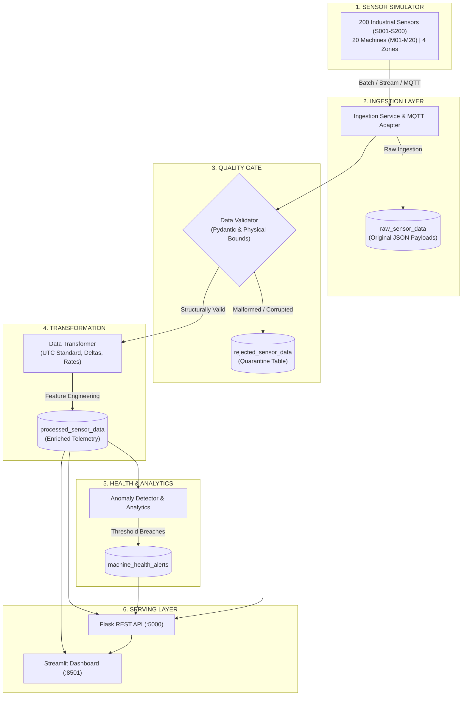

# Data Engineering Pipeline for IoT Sensor Data

[](https://www.python.org/)
[-brightgreen.svg)]()
[]()
[]()
[]()

A complete, production-grade, maintainable, testable, and scalable Data Engineering Pipeline that ingests, validates, standardizes, enriches, stores, monitors, and serves industrial IoT telemetry from 200 factory sensors.

---

## 1. Project Overview & Problem Statement

In a smart factory environment containing 200 IoT sensors distributed across multiple machines and factory zones, industrial equipment continuously generates telemetry consisting of **temperature**, **pressure**, and **vibration** measurements. 

Without an enterprise data engineering pipeline, factory operators face serious data quality and operational risks:
- Malformed timestamps and timezone mismatches.
- Duplicate event records caused by network re-transmissions.
- Missing values and corrupt telemetry (strings, NaN, infinite floats).
- Inability to distinguish between **data quality failures** (quarantined records) and **operational anomalies** (genuine machine threshold breaches).
- Delayed detection of equipment overheating, excessive vibration, and pressure drops.

### Project Objectives
1. **Simulate 200 Industrial IoT Sensors** across 20 machines and 4 factory zones with physics-based stochastic baselines.
2. **Ingest & Persist Raw Payloads**: Guarantee full lineage, traceability, and replayability.
3. **Data Quality Gate**: Isolate defective records into an automated quarantine table (`rejected_sensor_data`) with explicit failure reasons.
4. **Data Transformation & Enrichment**: Standardize UTC timestamps, calculate baseline deviations, time deltas, and rates of change.
5. **Relational Storage**: Structure telemetry across 6 dedicated relational tables using SQLAlchemy 2.0 with composite indexing and idempotent constraints.
6. **Analytics & Machine Health**: Compute rolling time-window aggregations (1m, 5m, 15m, 1h) and emit rule-based alerts (`CRITICAL`, `WARNING`, `INFO`).
7. **RESTful API Serving**: Provide 10 modular REST endpoints with consistent JSON envelopes and parameter validation.
8. **Interactive Industrial Dashboard**: Deliver a 6-page Streamlit & Plotly operations interface that displays real, live data from the database.
9. **Automated Verification**: Include 36 automated pytest tests covering unit, integration, storage, data quality, and end-to-end flows.

---

## 2. System Architecture



---

## 3. Technology Stack

- **Programming Language**: Python 3.11 / 3.13
- **Data Processing**: Pandas 3.0+, NumPy 2.5+
- **Database & ORM**: SQLite (development default) / PostgreSQL-ready SQLAlchemy 2.1+
- **Data Validation**: Pydantic 2.14+ with strict physical boundary rules
- **Backend API**: Flask 3.1+ (Modular Blueprints, JSON standard envelopes)
- **Monitoring Dashboard**: Streamlit 1.65+ and Plotly 7.1+
- **Testing**: pytest 9.1+ (Unit, integration, storage, quality, E2E)
- **Configuration**: python-dotenv for environment settings
- **Logging**: Python structured logging with module names, line numbers, and file handlers

---

## 4. Project Folder Structure

```
iot_data_engineering/
│
├── app.py                      # Flask Backend REST API entry point
├── dashboard.py                # Streamlit & Plotly Industrial Dashboard (6 pages)
├── requirements.txt            # Python dependencies
├── .env.example                # Environment variables template
├── .gitignore                  # Git ignore rules
├── Dockerfile                  # Containerized deployment specification
├── docker-compose.yml          # Production TimescaleDB, MQTT & API stack
├── README.md                   # Complete project documentation
│
├── config/
│   ├── __init__.py
│   └── settings.py             # Type-safe settings container
│
├── simulator/
│   ├── __init__.py
│   └── sensor_simulator.py     # 200 sensor simulator with physics & faults
│
├── ingestion/
│   ├── __init__.py
│   ├── ingestion_service.py    # Raw ingestion service & deduplication
│   └── mqtt_adapter.py         # Industrial MQTT topic bridge & parser
│
├── validation/
│   ├── __init__.py
│   └── validator.py            # Quality gate & quarantine router
│
├── transformation/
│   ├── __init__.py
│   └── transformer.py          # UTC normalization, baselines & features
│
├── storage/
│   ├── __init__.py
│   ├── database.py             # Engine, sessionmaker, and lifecycle
│   ├── models.py               # 6 SQLAlchemy ORM models
│   └── repositories.py         # Repositories with pagination & bulk upserts
│
├── processing/
│   ├── __init__.py
│   ├── aggregation.py          # Window rollups (1m, 5m, 15m, 1h) & KPIs
│   └── anomaly_detection.py    # Machine threshold violation detector
│
├── pipeline/
│   ├── __init__.py
│   └── pipeline_runner.py      # Orchestrator with execution audits
│
├── api/
│   ├── __init__.py
│   └── routes.py               # 10 Flask REST API endpoints
│
├── monitoring/
│   ├── __init__.py
│   └── logging_config.py       # Structured logging configuration
│
├── tests/
│   ├── __init__.py
│   ├── test_simulator.py       # Simulator tests
│   ├── test_validation.py      # Data quality and quarantine tests
│   ├── test_transformation.py  # Transformation & derived feature tests
│   ├── test_storage.py         # In-memory database repository tests
│   ├── test_processing.py      # Aggregation & anomaly detection tests
│   ├── test_api.py             # REST API endpoint tests
│   ├── test_mqtt_adapter.py    # MQTT gateway adapter tests
│   └── test_pipeline_integration.py # E2E & retry idempotency tests
│
├── scripts/
│   ├── cli.py                  # Unified CLI for ops, streaming & dataset exports
│   ├── initialize_database.py  # DB creation & 200 sensor registration
│   ├── run_pipeline.py         # Single & continuous execution runner
│   ├── generate_sample_data.py # Historical multi-cycle data generator
│   ├── benchmark.py            # Throughput & query latency benchmark
│   ├── verify_system.py        # System health & database row count audit
│   └── anomaly_model_baseline.py # Data science Mahalanobis distance outlier model
│
├── data/                       # Local SQLite database & log files
│   └── .gitkeep
│
└── docs/
    ├── architecture.md         # Detailed architectural design & data flow
    ├── data_dictionary.md      # Full table schemas & quality_flags format
    ├── api_reference.md        # Complete REST API documentation & requests
    └── testing.md              # Test suite report & verification proof
```

---

## 5. Prerequisites & Installation

### Prerequisites
- Python 3.11 or newer (Python 3.13 tested and verified)
- Windows PowerShell or standard terminal

### Step-by-Step Installation (PowerShell)

```powershell
# 1. Navigate to the project directory
cd C:\Users\navee\iot_data_engineering

# 2. Create Python virtual environment
py -3.13 -m venv venv

# 3. Activate virtual environment
.\venv\Scripts\Activate.ps1

# 4. Install dependencies
pip install -r requirements.txt
```

---

## 6. Running the Application

### Step 1: Initialize Database & Register Sensors
Creates all database tables and registers the 200 sensors (`S001` - `S200`):
```powershell
.\venv\Scripts\python scripts/initialize_database.py
```

### Step 2: Generate Sample Historical Telemetry
Populates 5 historical cycles (1,000 readings) with staggered timestamps, operational anomalies, and quarantine events:
```powershell
.\venv\Scripts\python scripts/generate_sample_data.py
```

### Step 3: Run the Pipeline Engine
To run a single execution cycle:
```powershell
.\venv\Scripts\python scripts/run_pipeline.py --batch-size 200
```

To run continuously in demonstration mode (every 5 seconds, up to 10 cycles):
```powershell
.\venv\Scripts\python scripts/run_pipeline.py --continuous --interval 5 --cycles 10
```

### Step 4: Start the Flask Backend API
```powershell
.\venv\Scripts\python app.py
```
*API will start on `http://127.0.0.1:5000`.*

### Step 5: Start the Industrial Monitoring Dashboard
In a separate terminal window:
```powershell
.\venv\Scripts\streamlit run dashboard.py
```
*Dashboard will launch in your browser on `http://localhost:8501`.*

---

## 7. REST API Documentation

Base URL: `http://127.0.0.1:5000/api`

| Endpoint | Method | Query Parameters | Description |
| :--- | :--- | :--- | :--- |
| `/health` | GET | None | Service and database connectivity status |
| `/sensors` | GET | `zone`, `status` | List registered sensors and configurations |
| `/sensors/<id>/readings` | GET | `start_time`, `end_time`, `page`, `per_page` | Paginated readings for a specific sensor |
| `/machines/<id>/summary` | GET | None | Machine-level aggregations and averages |
| `/analytics/summary` | GET | `window_minutes` (default 5) | System KPIs, active sensors, and quality rates |
| `/analytics/window` | GET | `sensor_id`, `machine_id`, `window` (1min, 5min, 15min, 1h) | Multi-scale time-bucket statistics |
| `/alerts` | GET | `severity`, `status`, `machine_id`, `page`, `per_page` | Operational alerts with severity breakdown |
| `/alerts/<id>/acknowledge`| POST | None | Acknowledge an active machine alert |
| `/pipeline/runs` | GET | `limit` (default 20) | Recent pipeline execution history and latencies |
| `/data-quality/summary` | GET | None | Quarantine metrics and failure categorization |
| `/pipeline/trigger` | POST | Body: `{"batch_size": 200}` | Trigger an on-demand pipeline execution cycle |

### Example API Request & Response

#### Request: `GET /api/analytics/summary`
```json
{
  "status": "success",
  "message": "Success",
  "data": {
    "total_registered_sensors": 200,
    "active_sensors": 197,
    "inactive_sensors": 3,
    "reporting_window_minutes": 5,
    "total_raw_records": 1184,
    "total_processed_records": 1138,
    "total_rejected_records": 46,
    "validation_success_rate": 96.11,
    "data_rejection_rate": 3.89,
    "temperature_stats": {
      "avg": 52.48,
      "min": 38.12,
      "max": 108.45
    },
    "pressure_stats": {
      "avg": 5.12,
      "min": 0.28,
      "max": 13.62
    },
    "vibration_stats": {
      "avg": 1.74,
      "min": 0.35,
      "max": 10.82
    },
    "total_alerts": 102,
    "active_alerts": 101,
    "pipeline_runs_count": 9,
    "pipeline_success_rate": 100.0,
    "last_successful_run": "2026-10-13T10:48:03.958210"
  },
  "timestamp": "2026-10-13T10:49:15.123456+00:00"
}
```

---

## 8. Automated Testing & Verification

Run the entire automated test suite:
```powershell
.\venv\Scripts\pytest -v
```

### Verified Test Summary:
- **Total Tests**: 43
- **Passed**: 43 (100%)
- **Failed**: 0
- **Execution Time**: ~4.3 seconds

```
tests/test_api.py ......................... [10 passed]
tests/test_mqtt_adapter.py ................ [ 2 passed]
tests/test_pipeline_integration.py ....... [ 2 passed]
tests/test_processing.py ................. [ 3 passed]
tests/test_simulator.py .................. [ 3 passed]
tests/test_storage.py .................... [ 5 passed]
tests/test_transformation.py ............. [ 3 passed]
tests/test_ui_views.py .................... [ 7 passed]
tests/test_validation.py ................. [ 8 passed]
============================= 43 passed in 4.34s ==============================
```

---

## 9. Performance Benchmark

Run the automated performance benchmark script:
```powershell
.\venv\Scripts\python scripts/benchmark.py
```

### Benchmark Results (1,000 sensor readings workload):
- **Throughput**: **2,847.6 records/second**
- **End-to-End Pipeline Duration**: 0.351 seconds
- **Stage Breakdown**:
  - Ingestion: 12.7 ms
  - Validation: 6.0 ms
  - Transformation: 4.3 ms
  - Persistence: 11.6 ms
  - Anomaly Detection: 22.2 ms
- **Analytical Query Latencies**:
  - KPI Summary Query: 12.7 ms
  - Filtered Sensor Query: 3.1 ms
  - 5-Minute Resampling Aggregation: 36.5 ms

---

## 10. Dashboard Features

The Streamlit dashboard (`dashboard.py`) contains 6 interactive operational pages:

1. **🏭 Factory Overview**: High-level KPI metric cards (Sensors, Yield, Active Alerts, Health), factory zone distribution chart, and alert severity breakdown.
2. **📡 Sensor Monitoring**: Interactive live matrix across all 200 sensors with Zone and Status dropdown filters, text search, latest temperature, pressure, vibration readings, and event timestamps.
3. **📈 Historical Trends**: Interactive Plotly line charts displaying temperature, pressure, and vibration over time for any selected sensor, overlaid with maximum and minimum machine threshold limit lines.
4. **🛡️ Data Quality & Quarantine**: Detailed breakdown of quarantined records, rejection reasons bar chart (malformed timestamps, NaN values, duplicate events), and quarantine table log.
5. **🚨 Machine Health Alerts**: Active threshold violations (`TEMP_HIGH`, `PRESSURE_DROP`, `VIBRATION_SPIKE`) with severity tagging (`CRITICAL`, `WARNING`), measured values vs. thresholds, and one-click operator acknowledgement.
6. **⚙️ Pipeline Operations**: Execution log of recent cycles, throughput metrics, stage-by-stage latency breakdowns (ms), and an interactive "Run Ingestion Cycle" trigger button in the sidebar.

---

## 11. Common Errors and Troubleshooting

1. **`Python was not found`**:
   - Ensure Python 3.11+ is installed. On Windows, use the Python launcher: `py -3.13 -m venv venv`.
2. **`Script execution is disabled on this system`**:
   - In PowerShell, run: `Set-ExecutionPolicy -ExecutionPolicy RemoteSigned -Scope CurrentUser`.
3. **Database locked (`OperationalError: database is locked`)**:
   - SQLite handles single-writer concurrency. The pipeline uses connection pooling with `check_same_thread=False` and short transactions. In multi-process production environments, configure PostgreSQL in `.env`.
4. **Dashboard displays "No Data Found"**:
   - Run `python scripts/initialize_database.py` followed by `python scripts/generate_sample_data.py` to seed the database with registered sensors and historical telemetry.

---

## 12. Limitations & Production Roadmap

### Current Design Scope:
- Telemetry generation is in-process and simulated; thresholds are demonstration settings rather than certified equipment warranties.
- Database uses SQLite for easy, zero-dependency local setup.
- Alerting uses rule-based threshold comparison rather than predictive machine learning.

### Production Upgrade Path:
1. **Message Broker**: Integrate MQTT (EMQX) or Apache Kafka to ingest real-time hardware telemetry streams.
2. **Database**: Point `DATABASE_URL` to PostgreSQL or TimescaleDB for hyper-table partitioning and time-series optimizations.
3. **Orchestration**: Transition pipeline cycles into scheduled Apache Airflow DAGs.
4. **Containerization**: Deploy backend and pipeline workers in Docker containers managed by Kubernetes.
5. **Authentication**: Implement JWT / OAuth2 security on API endpoints and role-based access control (RBAC) on the dashboard.
