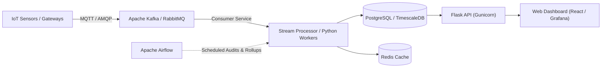

# System Architecture: IoT Sensor Data Engineering Pipeline

## 1. High-Level Architecture Overview

This project implements an end-to-end data engineering pipeline designed to handle industrial IoT sensor readings from 200 factory sensors. The architecture ensures that raw data is captured immutably, verified for structural and data quality defects, transformed with derived operational features, persisted across segregated relational tables, evaluated for operational anomalies against machine-specific limits, and exposed via REST APIs and an interactive Streamlit monitoring dashboard.

```mermaid
flowchart TD
    subgraph Data_Generation ["1. Data Acquisition"]
        Sim["Sensor Simulator (200 Sensors, 20 Machines)"]
    end

    subgraph Ingestion_Layer ["2. Data Ingestion Layer"]
        Ingest["Ingestion Service"]
        RawDB[("Raw Sensor Storage (raw_sensor_data)")]
    end

    subgraph Quality_Gate ["3. Validation & Quality Gate"]
        Validator["Data Validator (Schema & Physical Sanity)"]
        Quarantine[("Quarantine Storage (rejected_sensor_data)")]
    end

    subgraph Transformation_Layer ["4. Transformation & Feature Engineering"]
        Transformer["Data Transformer (UTC, Baselines, Deltas, Freshness)"]
        ProcDB[("Processed Telemetry (processed_sensor_data)")]
    end

    subgraph Processing_Layer ["5. Health Monitoring & Aggregation"]
        Anomaly["Anomaly Detector (Thresholds & RoC)"]
        AlertsDB[("Alerts Storage (machine_health_alerts)")]
        Analytics["Analytics Engine (KPIs & Window Aggregations)"]
    end

    subgraph Serving_Layer ["6. Serving & Presentation"]
        API["Flask REST API (:5000)"]
        Dashboard["Streamlit Industrial Dashboard (:8501)"]
    end

    subgraph Orchestration ["7. Pipeline Orchestration"]
        Runner["Pipeline Runner (Cycles & Run Audits)"]
        RunsDB[("Execution Audits (pipeline_runs)")]
    end

    Sim -->|Batch / Stream| Ingest
    Ingest -->|Raw JSON Payloads| RawDB
    Ingest --> Validator
    Validator -->|Corrupted / Malformed| Quarantine
    Validator -->|Structurally Valid| Transformer
    Transformer -->|Normalized Records| ProcDB
    ProcDB --> Anomaly
    Anomaly -->|Violations (WARNING/CRITICAL)| AlertsDB
    ProcDB --> Analytics
    Analytics --> API
    ProcDB --> API
    AlertsDB --> API
    Quarantine --> API
    API --> Dashboard
    ProcDB --> Dashboard
    AlertsDB --> Dashboard
    Quarantine --> Dashboard
    Runner -.-> Ingest
    Runner -.-> Validator
    Runner -.-> Transformer
    Runner -.-> Anomaly
    Runner --> RunsDB
```

---

## 2. Component Design & Decoupling

### 2.1 Sensor Simulation Engine (`simulator/sensor_simulator.py`)
- Simulates 200 sensors (`S001` - `S200`) mapped to 20 machines (`M01` - `M20`) across 4 factory zones (`Zone-North`, `Zone-East`, `Zone-South`, `Zone-West`).
- Physics-based stochastic baselines for Temperature (40-60 °C), Pressure (3.5-6.5 bar), and Vibration (0.9-2.0 mm/s).
- Simulates deliberate operational anomalies (extreme values crossing configured limits) and data quality faults (corrupted timestamps, NaN values, missing IDs) to rigorously exercise the validation and alerting engines.
- Deterministic reproducibility supported via optional random seeds.

### 2.2 Data Ingestion Layer (`ingestion/ingestion_service.py`)
- Accepts single records and batch payloads.
- Attaches UTC ingestion timestamps.
- Idempotently writes raw payloads to `raw_sensor_data`. If an `event_id` was already ingested, it is flagged as a duplicate rather than causing an unhandled integrity violation.
- Full payload JSON strings are preserved for lineage, auditability, and replay capability.

### 2.3 Data Validation Engine (`validation/validator.py`)
- Employs Pydantic schemas (`SensorReadingSchema`) and explicit physical constraints.
- **Data Quality Failure vs. Operational Anomaly**:
  - *Data Quality Failure*: Unparseable timestamp, timestamp > 120s in future, NaN/Inf numeric values, missing `sensor_id` or `event_id`, absolute temperature < -273.15 °C, negative absolute pressure. **Action**: Segregated to `rejected_sensor_data` quarantine table with exact failure reason.
  - *Operational Anomaly*: Structurally valid measurement that exceeds machine threshold limits (e.g. 95 °C). **Action**: Valid record is preserved and transformed; an alert is generated separately.

### 2.4 Data Transformation Engine (`transformation/transformer.py`)
- Standardizes timestamps to naive UTC for SQL consistency.
- Preserves explicit `None`/`NULL` values without zero-substitution (avoiding false zeros).
- Computes stateful derived features:
  - `temp_deviation`, `press_deviation`, `vib_deviation` from baseline.
  - `seconds_since_last_event` and rates of change (`temp_rate_of_change_per_sec`).
  - `freshness_seconds`.
- Stores enriched features in `quality_flags` JSON column.

### 2.5 Storage Layer (`storage/`)
- Relational schema with primary keys, uniqueness constraints, and multi-column indexes on `(sensor_id, event_timestamp)` and `(machine_id, event_timestamp)`.
- Implements Repository Pattern (`storage/repositories.py`) for clean database operations, pagination, and transactional isolation.

### 2.6 Analytics & Anomaly Detection (`processing/`)
- **Analytics Engine**: Calculates high-level KPIs, active/inactive sensor status based on configurable reporting windows (default 5 min), machine summaries, and multi-scale resampling (1m, 5m, 15m, 1h).
- **Anomaly Detector**: Checks measurements against per-machine/sensor operating limits. Emits alerts classified by severity (`CRITICAL`, `WARNING`, `INFO`). Enforces uniqueness on `(event_id, alert_type)` to avoid duplicate alert storms on re-runs.

### 2.7 Data Serving API (`api/` and `app.py`)
- Modular Flask application using Blueprints (`/api/*`).
- Consistent JSON envelope format, parameter validation, HTTP status codes, and exception trapping.

### 2.8 Monitoring Dashboard (`dashboard.py`)
- Interactive Streamlit dashboard using Plotly charts.
- 6 dedicated operations pages: Factory Overview, Sensor Monitoring, Historical Trends, Data Quality & Quarantine, Machine Health Alerts, Pipeline Operations.
- Connects directly to database and analytics engine; zero fabricated data.

---

## 3. Transaction Boundaries and Error Recovery

1. **Transactional Scopes**: Every pipeline cycle runs within a managed transaction context (`get_db_session()`).
2. **Failure Isolation**: A corrupted record does not cause the entire batch to abort; the validator routes corrupted records to quarantine while allowing valid records to proceed.
3. **Idempotent Retry Safety**:
   - `raw_sensor_data`: Checked against existing `event_id`s prior to insert.
   - `processed_sensor_data`: Checked against existing `event_id`s.
   - `machine_health_alerts`: Unique constraint on `(event_id, alert_type)` prevents duplicate alerts.
   - Reprocessing an existing batch results in zero duplicate processed records or alerts.
4. **Audit Trail**: Every execution cycle is tracked in `pipeline_runs` with start/end timestamps, record counts, stage latencies, error counts, and status (`COMPLETED`, `FAILED`, `PARTIAL`).

---

## 4. Production Upgrade Path



To scale this local architecture to an enterprise production deployment:
1. **Message Broker**: Replace in-process simulation with an MQTT broker (EMQX / Mosquitto) or Apache Kafka topic.
2. **Database**: Switch `DATABASE_URL` in `.env` from SQLite to PostgreSQL or TimescaleDB. The SQLAlchemy ORM models and queries are already PostgreSQL-compatible.
3. **Orchestration**: Transition `PipelineRunner` cycles into scheduled DAGs in Apache Airflow or Prefect.
4. **Containerization**: Deploy backend and pipeline workers in Docker containers orchestrated via Kubernetes.
